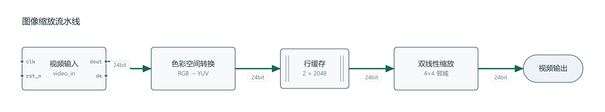
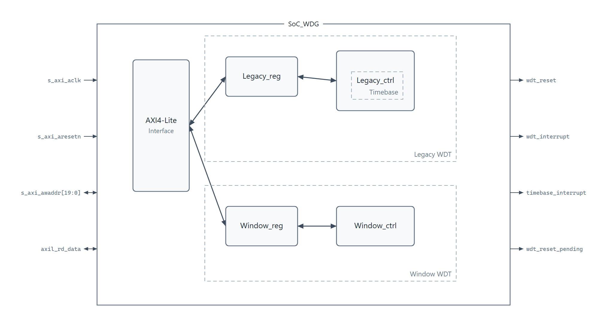
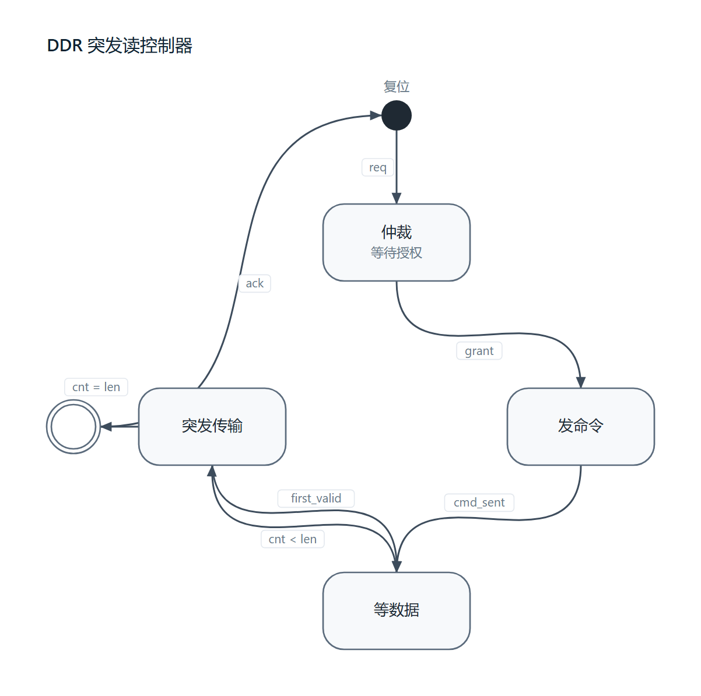
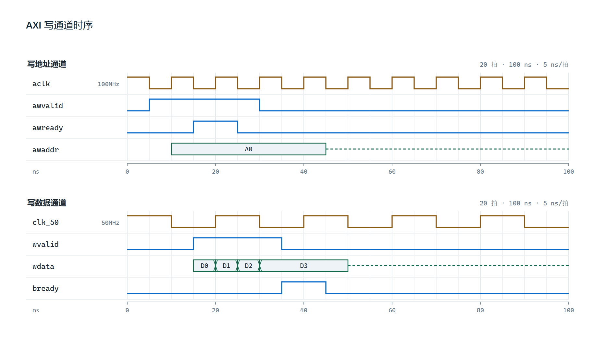

# FPGA Diagram

在 VS Code 里画 **FPGA 系统框图 / 状态机 / 时序波形**。
和 draw.io 的区别很简单：**你写文字，它算坐标**。所以它既能给人拖，也能被 AI 直接生成。

```yaml
diagram_type: system_block
nodes:
  - {id: vin,  type: io,     label: 视频输入, ports: "r:dout"}
  - {id: scal, type: module, label: 双线性缩放, ports: "l:din | r:dout"}
  - {id: vout, type: io,     label: 输出}
edges:
  - vin.dout -> scal.din : 24bit bus
  - scal.dout -> vout : straight
```

上面这段就是一张图。打开画布，它长这样：



## 三种视图

| 模板 | 内容 |
|---|---|
| **系统框图** | 层次框（实线/虚线、可嵌套）+ 子模块 + 框边界信号，画顶层硬件框图 |
| **状态机** | 状态 / 转移 / 条件，环形布局 |
| **时序波形** | 时钟（按频率）/ 单比特 / 总线，可刷波形；一张图里能排多组时序 |

顶部是**视图页签**：一张框图、一台状态机、几组时序可以放在同一个 `.fpgad` 里，点页签切换，
**互不覆盖、切走再切回内容都在**（页签「＋」新增，双击改名）。

层次框图长这样——外包一个 `frame`，里面放虚线子框和模块，信号从框边界穿出去：



## 三种图

| 类型 | DSL 声明 | 长这样 |
|---|---|---|
| 系统框图 | `diagram_type: system_block` |  |
| 状态机 | `kind: fsm` |  |
| 时序波形 | `kind: timing` |  |

图形库只做 FPGA 常用的那些，不做通用画图：

- **系统框图**：模块、IO 端口、层次框、分组、判断、注释；顶层连接默认走直线
- **状态机**：状态、初始实心点、结束双圆、判断节点，转移可写 `条件 / 动作`，支持自环
- **时序**：时钟（写 `freq: 100` 就是 100MHz，多时钟自动对齐）、单比特信号（`0/1/z/x`）、
  总线（分段带值标签，`z` 表示释放）、ns 时间轴与网格；一张图可纵向排多组时序，各有时长

## 安装

仓库根目录直接带了发行版安装包，克隆后一条命令即可安装，不需要先构建：

```bash
code --install-extension fpga-diagram-2.0.1.vsix
```

要自己从源码出包：

```bash
npm install
npm run build
npm test             # 解析 / 序列化 / 布局 / 交互回归，67 个用例
npm run package      # 产出 fpga-diagram-2.0.1.vsix
code --install-extension fpga-diagram-2.0.1.vsix
```

开发调试：用 VS Code 打开本目录，按 `F5` 起扩展宿主。
测试用 esbuild 打包 + `node --test`，不引入 jest 之类的额外运行时；CI 跑 tsc + test + build。

## 用法

- 命令面板搜 **FPGA 图表**：新建系统框图 / 状态机 / 时序
- 资源管理器右键文件夹：新建图表
- 已有 `.fpgad` 文件双击即打开画布；点工具栏 **源码** 切到文本编辑（有补全、Git diff、snippet）
- 工具栏可 **导出 SVG**（矢量，插文档）或 **导出 PNG**（2x）

画布上能做的事：

| 操作 | 方式 |
|---|---|
| 选中 / 多选 | 单击 / Ctrl+单击 / 空白处拖框选 |
| 移动 | 拖动图形，网格吸附；方向键微调（Shift 加大步长） |
| 改尺寸 | 角上的手柄拖动（层次框 / 分组也支持） |
| 加端口 | 右侧「＋端口」选 input / output / inout；默认分别落到左 / 右 / 空白边 |
| 加连线 | 从图形边缘的圆点（引脚或锚点）拖到目标图形 |
| 改文字 | 双击图形 / 双击连线 |
| 对齐分布 | 多选后工具栏出现 6 个对齐按钮 |
| 撤销重做 | Ctrl+Z / Ctrl+Y |
| 缩放平移 | 滚轮缩放；按住右键 / 中键 / 空格+左键拖动平移；工具栏 ± 以画布中心缩放 |
| 画布外观 | 工具栏切换「跟随 / 白底 / 黑底」，「网格线」可独立开关；「中心点」显示视口中心的十字准星（缩放与新增节点都以此为准，仅屏幕提示，不进入导出） |
| 批量改波形 | 时序图里选笔刷（翻转/0/1/Z/X/值…），在格子上拖过去 |
| 改总线值 | 选「值…」笔刷点格子（或在右侧段编辑器里加段/改值/挪起点） |
| 加信号 | 左侧「＋ 信号」→ 时钟/单比特/总线/分组；时钟在右侧填频率 |
| 加时序组 | 左侧「＋ 组」：同一张图再加一组，各有自己的拍数与时间轴 |

拖动只回写 `pos: [x, y]` 到文件，**注释和排版都保留**；改结构才整文件重写。
把左侧图形直接拖到一条连线上，会在**箭头中间**插入一个模块，并把两条箭头接到它对侧边的中点。

## 给 AI 用

三层入口，能力一样：

**1. 直接写文件**（最省事）—— AI 生成 `.fpgad`，打开即渲染。

**2. 命令行**（无 GUI 也能校验出图，适合脚本/Copilot Terminal）

```bash
npx fpga-diagram render   a.fpgad -o a.svg --scale 2
npx fpga-diagram validate a.fpgad --json     # 带行号的错误，AI 可直接自修正
npx fpga-diagram fmt      a.fpgad            # 归一化格式
npx fpga-diagram new fsm  -o b.fpgad         # 生成模板
```

**3. VS Code Chat 工具** —— 装了本扩展后，Chat 里说“画个 AXI 突发读状态机”，
模型会调用 `fpga_draw_diagram` 工具落盘并打开（需 VS Code 1.95+）。

**4. MCP server**（对外部 Agent 开放）

```jsonc
// Claude Desktop / Cursor / 任意 MCP 客户端
{
  "mcpServers": {
    "fpga-diagram": {
      "command": "node",
      "args": ["D:/path/to/fpga-diagram/out/cli.js", "mcp"]
    }
  }
}
```

暴露 3 个工具：`fpga_diagram_render`（出 SVG/`.fpgad`）、`fpga_diagram_validate`（自检）、
`fpga_diagram_example`（取模板）。

完整语法手册见 [`docs/DSL.md`](docs/DSL.md)（命令面板 → **打开语法速查**，可直接丢给 AI 或 `#file:` 引用）。

### 设计取舍：为什么是文本 DSL 而不是 JSON

AI 画图的主要成本是**写坐标**。所以这里把格式拆成两层：文件只描述语义（谁连谁），
坐标由布局器算；人拖完之后坐标才回写成 `pos` 覆盖值。结果是 AI 写 10 行就能出一张排版正常的图，
而人手改过的位置也不会被下一次 AI 生成冲掉。

## 工程结构

```
src/core/     纯 TS，不依赖 vscode 与 DOM：parse · layout · render · serialize
src/editor/   custom editor（webview 宿主）
src/webview/  画布交互层（复用 core 渲染，只加拖拽）
src/cli.ts    命令行入口
src/mcp.ts    MCP server（stdio）
docs/DSL.md   语法速查
samples/      示例图（含多视图与多组时序）
```

打包只有两个运行时依赖：`js-yaml` 解析 DSL，`esbuild` 打包。

## 已知限制

- 目前只渲染，不支持导出 `.drawio` / `mmd` 等其它格式
- 时序图行数很多时不做虚拟滚动（几百行以内没问题）
- 分组框（`group`）按 `children` 自动包围，不支持嵌套多层

## License

MIT
